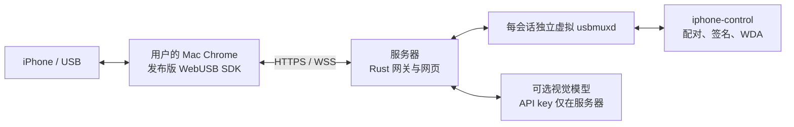

# Chrome 手机控制台（iPhone / Android）

在自己的 Mac 上插入 iPhone，用 Chrome 授权 USB，再从网页发起手动操作或自然语言任务。浏览器负责真实 USB 数据转发，服务器运行 Rust 网关 `iphone-control-gateway`、现有 Rust 控制引擎 `iphone-control`、WDA 准备和可选 AI。生产环境由同一 HTTPS origin 提供网页、REST API 和 WebSocket。



网页必须保持打开。所选 iPhone 拔出 USB 时，页面会立即显示断开并关闭对应 WebSocket 与会话；其他设备的拔出事件不会影响当前会话。部署后的用户 Mac 无需额外安装原生 helper；服务器必须安装原生引擎。仅部署静态网页不能提供手机控制。把服务器在本机启动，是开发时模拟云端角色，不能据此称为已部署云服务。

## Android（浏览器 WebADB，实验性）

连接面板选择 **Android**，使用 Android 8+、支持 WebUSB 的 Chrome 及可传数据的 USB 线。先在手机「开发者选项」开启 USB 调试，再在手机上允许当前浏览器的 RSA 授权。退出本地 `adb`、Android Studio、scrcpy 和占用同一设备的其他标签页，释放 USB 接口。Android 不使用 Apple ID、Apple 配对记录、开发者签名或 WDA；iPhone 连接流程保持独立。Windows 还可能需要设备厂商提供的 USB 调试驱动，未做 Windows 真机认证。

浏览器使用固定版本的 Tango WebADB SDK，与设备直接认证。每个浏览器独立生成并保存调试私钥，私钥不会上传服务器；撤销授权可在手机的 USB 调试设置中完成。临时推送并启动官方 scrcpy 3.3.3 server（约 90 KB、Apache-2.0、SHA-256 校验），建立输入和画面通道，不安装 APK、不传音频、不自动同步手机剪贴板。中文输入使用「设置剪贴板并粘贴」，会覆盖手机剪贴板，部分安全输入框或厂商系统可能拒绝粘贴。官方来源和许可证位于 `web/android/vendor/NOTICE`，构建产物的 `licenses/` 也包含许可证。

手动与 AI 操作共用同一会话队列：截图、点按、长按、滑动、中文输入、主屏幕/返回/锁屏/音量、列出/启动/结束应用、打开 URL、查询和等待界面元素。兼容 API 仍使用 `iphone_*` 工具名；Android 应用参数必须是 `list_apps` 返回的 Android package ID。时钟等厂商可变包名不走 iOS 快捷指令。旋转或显示尺寸无法核实时，坐标动作会报错，要求刷新截图。多显示器暂不支持。受保护的画面可能无法截图。

`/device/ws` 沿用现有 origin 校验、短期会话令牌、1 MiB 帧上限与单连接所有权。Android 设备 ID 使用区分大小写的 `android:` 命名空间，同一设备不能被多个服务端会话同时占用。动作不自动重试，取消会丢弃尚未派发的动作。支持 WebCodecs 时优先由设备编码 H.264（最长边 1280 像素、上限 10 fps / 2 Mbps），浏览器解码后取新画面转为 JPEG 上传；通道不可用时退回系统 PNG 截图并在浏览器缩放。连续视频只在设备和浏览器之间传输。采图核对原生显示方向，方向或尺寸变化后等待新的编码配置和画面；坐标与元素边框统一换算。识别阶段并行采图和限时查询元素树，界面树不可用时保留截图。截图与元素查询耗时分别记录；模型上下文省略空布局节点，保留无标签但可聚焦的输入控件。

适配器、取消/去重和真实 Rust 网关 WebSocket 集成测试使用明确标注的 ADB/截图 fixture；它们与下述 Xiaomi 平板实测分开记录，不代表所有机型的 USB 兼容性或任务成功率。Windows、多显示器和其他 Android 版本仍待验证。

### 已完成的平板实测（2026-11-10）

Xiaomi Pad 6S Pro 12.4 / Android 14，通过 Mac Chrome 的 WebUSB 连接本地 Rust 网关，已验证真实截图、桌面双向滑动、截图坐标打开设置、长按设置图标菜单、主屏幕和返回键、包名启动设置，以及在设置搜索框中粘贴中文。横屏和竖屏均验证了画面及坐标操作；竖屏视频截图为 856×1280，稳定采图为 115–116 ms。旋转过渡期间曾出现约 3.3 秒排队，稳定采图时延不包含这段过渡。纯控制模式显式关闭设备名称头，并为关闭剪贴板自动同步的 SDK 注册独立 ACK 协议处理，避免粘贴失败及控制流提前关闭。

Chrome Network 中 5 次空闲设置页面 `/preview` 请求为 494、501、470、482、512 ms，中位数 494 ms；每次传输约 73–74 kB（含 base64/JSON）。这是本机 USB 采图、压缩及网关往返测量，不含视觉模型推理，也不代表所有安卓设备、画面或网络环境的表现。iPhone 真机测速由用户安排后续进行。

随后在同一平板桌面发现系统 PNG 原图约 4.9 MB，采图约 2920 ms。改用 H.264 后，5 次真实 `/screen` 请求的 `timings.screenshotMs` 为 112、119、120、134、110 ms，中位数 119 ms，较这次 PNG 基线缩短约 96%。截图已验证为实际桌面，坐标点击能打开设置。该比较是单次 PNG 基线与 5 次视频采图样本，不能视为跨设备统计。`/screen` 总耗时仍约 1 秒，因为元素树查询达到 1 秒预算；这些数字均不含模型推理，`sourceBytes` 在视频模式下表示两次采图间接收的编码字节数。

## Rust/WASM 浏览器客户端

安装依赖及启动前端构建时，会校验并修补固定版本的 iPhone USB SDK：按长度重组 USB 分段读取中的 usbmux 报文，关闭连接时释放底层流、处理 FIN/RST，并允许取消正在建立的连接。发送按设备累计 ACK 和接收窗口限流，在异步 USB 写入前预留序号；每条流独立排队，零窗口不会阻塞心跳、取消或其他流，待发数据最多 1 MiB。补丁仅用于浏览器 ESM 入口，兼容先前 v1/v2 补丁升级；版本或源码校验不符时构建会失败，需要复核补丁。回归测试使用合成 USB peer，WDA 长时间真机稳定性仍需单独验证。

任务最多执行 100 步，总时限为 30 分钟。任务输入框支持选择、粘贴和拖入 JPEG/PNG 图片，可预览和移除。每个会话最多 6 张，单张 5 MiB，总计 20 MiB。模型能查看参考图片，并获得用于手机 Safari 打开的短期链接。发帖配图需要先通过手机系统界面保存到照片，再从目标 App 选图，导入结果以真机界面为准。

iPhone 预览优先使用 WDA 的独立 MJPEG 通道，在 AI 思考和操作期间持续更新。连接不可用时使用截图后备，过旧的流画面会暂停手动点击。预览链接只能读取对应会话的画面，会话结束后失效。

浏览器页面由 `crates/ictl-web/src/ui` 的 Leptos CSR 组件生成。会话、HTTP、轮询、手势、Android 命令和视频帧管理位于同一个 Rust crate。`web/main.mjs` 加载 WASM 并挂载页面，`web/android` 和 `web/client.mjs` 保留第三方 SDK 的构造和互操作桥。

本地构建需要 Rust 1.90.0、`wasm32-unknown-unknown` 编译目标、与锁定依赖匹配的 wasm-bindgen CLI 0.2.130，以及 Node 22.13+。

```bash
rustup toolchain install 1.90.0
rustup target add --toolchain 1.90.0 wasm32-unknown-unknown
cargo +1.90.0 install wasm-bindgen-cli --version 0.2.130 --locked
```

也可用 `WASM_BINDGEN_BIN` 指定已校验的 CLI 路径。`npm run build` 编译优化后的 release WASM，再生成 Vite 资产；`npm test` 编译调试 WASM 和根路径页面后运行测试。生成的 `pkg/`、`pkg-node/` 和 `dist/` 已加入 Git 忽略规则。`npm run typecheck` 检查 Rust/WASM 编译，`npm run test:browser` 用 Playwright 启动 Chrome/Chromium 验证页面。Mac 默认使用已安装的 Google Chrome，其他平台先执行 `npx playwright install chromium`，也可通过 `CHROME_BIN` 指定浏览器。

## 本地开发

需要 Rust 1.90.0、Node 22.13+、Mac Chrome，以及服务器侧可执行的 `iphone-control`。Node 用于 SDK 打包和浏览器测试，运行中的网关为 Rust 可执行文件。当前源码基于 0.1.4，包含 Apple 登录连接复用和网页管道输入的兼容补丁。使用 Rust 1.88+ 在仓库根目录执行 `cargo build --release --locked -p iphone-control -p ictl-gateway`，将 `ICTL_BIN` 指向生成的 `target/release/iphone-control`。然后从仓库根目录执行：

```bash
cd browser-control
npm ci
cp .env.example .env
# 编辑 .env：替换 CONTROL_ACCESS_TOKEN，并设置 ICTL_BIN 为原生二进制路径
npm run build
GATEWAY_BIN="$(cd ../target/release && pwd)/iphone-control-gateway" npm start
```

打开 [http://127.0.0.1:8787](http://127.0.0.1:8787)，在页面粘贴服务器访问令牌并点击「连接 iPhone」。令牌仅在本页内存中使用。首次连接需要解锁手机、信任电脑，并根据原生向导完成开发者模式、Apple 账号与 WDA 签名。

前端热更新可另开终端运行 `npm run web:dev`，访问 [http://127.0.0.1:5173](http://127.0.0.1:5173)。Vite 将 `/api`、`/device` 与 `/ios` 代理至 `127.0.0.1:8787`；页面服务器地址留空即可。`.env.example` 包含这两个开发 origin。`npm start` 和 `npm run dev` 通过脚本启动 Rust 网关，默认由 Cargo 构建运行，也可在 shell 中设置 `GATEWAY_BIN` 指向预编译网关。Rust 启动时读取当前目录的 `.env`，shell 环境变量优先，原生子进程继承这些配置。安装多个工具链时可指定 `RUSTUP_TOOLCHAIN=1.90.0`。更改前端后，生产入口需要重新 `npm run build`。

```bash
cargo test --locked --manifest-path ../Cargo.toml -p ictl-gateway
npm test
npm run test:rust
npm run typecheck
npm run build
```

Rust 入口测试通过独立服务进程验证 HTTP/WebSocket/TCP/Unix Socket 和原生 CLI fixture。`npm run test:rust` 自动构建网关，也可使用 `RUST_GATEWAY_BIN` 指定已构建的绝对路径。迁移前的 Node 实现移至 `tests/reference`，供原测试作为兼容性参照。测试也包含发布版 SDK 的 `requestUSBAccess → pairDevice` 集成：一个明确标注的假 USB peer 回应 usbmux 版本握手，用假原生控制器与真实网关验证接口回退、恢复配对、关闭和删除会话。它没有模拟物理 iPhone、Apple 登录、Lockdown 授权或 WDA 控制成功。

## 页面行为（iPhone 流程）

空白设备框表示尚无真实截图。Chrome 点击事件会立即调用 SDK 的 USB chooser，再读取 IndexedDB 配对记录、创建服务端会话并配对。原始现代 USB serial 统一转成 8-16 UDID，命令使用创建接口返回的 `deviceId`。发布版 SDK 负责候选配置遍历、接口申请、usbmux 通信和配对。接入层增加两处传输适配，服务器按 USB 单包发送上限拆分 StreamData，浏览器按长度头组装完整接收包并保留后续包。原生 WebUSB getter 和方法绑定回真实 USBDevice，USB 断开监听保留原始设备引用。

`GET /api/sessions/:id` 的 `ready` 只表示原生 JSON 控制通道就绪。页面检查 `daemon.state.state === 'ready'` 后才启用 WDA 手动控制和 AI 任务。AI 未配置时仍可手动控制。手机截图的 JPEG 像素已由原生引擎换算为点击点，页面按图片实际尺寸与留白换算点按、滑动和长按，最长 10 秒。

配对期间会继续读取设备准备输出。只在原生向导提示时提交单行账号、密码或验证码；输入提交前立即清空。账号和签名由所配置服务器处理，浏览器不发送模型 API key。配对记录由 SDK 存入 IndexedDB；原生账号与签名资料保留在服务器隔离的运行目录中，重连可恢复。

取消连接会立即显示离线并禁用设备控制。若 SDK 配对或 USB 释放尚未结束，页面显示「等待 USB 释放」并暂时禁用重连，避免旧配对清理关闭新连接的同一 USB 设备。请等待处理结束；长时间未结束时，可刷新页面后重试。服务端 DELETE 等待最多 5 秒，但这个时限不会解除仍在进行的 SDK 配对或 USB 释放。

AI 任务执行期间暂停手动操作。确认框显示具体操作、参数和原因；拒绝即停止任务。停止会阻止后续步骤，停止前已送出的操作可能仍已执行。动作、任务创建、确认和准备输入都不自动重试，超时后应查看手机再决定下一次操作。

### 画面与识别性能

网页通过 `/api/sessions/:id/preview` 获取纯图片，预览不会读取元素树。AI 运行期间该接口直接返回任务最近采集的真实画面；首张观察尚未完成时返回 `null`，页面保留现有画面。任务状态每秒独立刷新，不再等待截图完成。设备空闲时短时间内的并发预览合并，设备命令执行后会使预览缓存失效。

AI 的 `/screen` 通过一个原生 `observe` 请求在同一设备锁内取得截图和元素树。只检查一次解锁状态，图片方向供元素树解析复用。原生引擎将只读元素快照限制为 1 秒，超时后模型按截图继续判断；已有 MCP 客户端默认保持原来的快照超时。升级必须同时构建网关和原生引擎，旧引擎不支持 `observe`。

浏览器会话默认启用 `ICTL_LOW_LATENCY=1`：创建 WDA 会话时请求源端高质量 JPEG，并复用低延迟等待设置。设置未被 WDA 明确确认时恢复普通手势路径。确认成功的会话中，点击保留 200 毫秒绘制窗口，滑动仍保留原有稳定检测。图片点尺寸、横竖屏及区域坐标换算保持一致；`ICTL_LOW_LATENCY=0` 可关闭设备端 JPEG/等待配置，重新连接后生效。

WDA HTTP 连接按完整响应边界复用。超时、取消、不完整响应会丢弃连接；空闲连接失效时仅 GET 最多重连一次，发出的 POST/动作不重放。`Connection: close` 或无明确消息边界的响应不入连接池。

查询工具的有界文字结果直接作为下一轮只读证据，区域截图本身作为下一轮图像，避免重新采集整屏。没有当前图像的查询结果不能直接触发坐标动作，模型必须重新观察并规划。完全匹配“回到主屏幕 / go home”、“打开设置 / open settings”、“打开时钟 / open clock”的单步请求省略首次模型规划，动作后仍观察并调用模型验证；复合或否定指令走普通流程。查询内容不写入轮询的任务快照。

任务面板显示最近一轮的观察、模型和操作耗时；API 的 `timings.capture` 进一步区分队列、截图和元素耗时，并提供 `sourceFormat` 和 `sourceBytes`（源图像二进制大小，不含 base64/HTTP 开销）。自动化覆盖模拟 WDA/USB/模型，实际公网耗时、手机文字清晰度及任务成功率仍需真机测量。

## 环境变量

| 变量 | 用途 |
|---|---|
| `CONTROL_ACCESS_TOKEN` | 必填，创建会话的服务器访问令牌；使用长随机值 |
| `ALLOWED_ORIGINS` | 逗号分隔的完整允许 origin，包含协议和端口；部署时只填写实际 HTTPS 网站 |
| `HOST` | Rust HTTP 监听地址，默认 `127.0.0.1`；容器内为 `0.0.0.0` |
| `PORT` | HTTP 与 WebSocket 共用端口，默认 `8787` |
| `RUNTIME_DIR` | 每会话原生数据和配对恢复索引目录，默认 `.runtime` |
| `PUBLIC_BASE_URL` | 反向代理外部 HTTP(S) origin，决定返回的 ws/wss relay 地址 |
| `ICTL_BIN` | 从当前源码构建的 `iphone-control` 可执行路径 |
| `ICTL_LOW_LATENCY` | 浏览器启动的原生引擎默认 `1`；`0` 关闭设备端 JPEG/持久等待配置，重连生效 |
| `WEB_DIST_DIR` | 前端构建目录，默认 `dist`，从仓库根目录运行时自动识别 `browser-control/dist` |
| `LLM_BASE_URL` | 可选模型兼容 API 根地址，如 `https://provider.example/v1`，不含账号、query 或 fragment |
| `LLM_MODEL` | 默认模型名称，页面可从服务商模型列表中另选 |
| `LLM_API_KEY` | 可选模型 key，仅配置于服务器环境 |

模型三个变量缺一即为未配置。当前客户端向 `/chat/completions` 发送视觉 Chat Completions 请求，使用 `temperature: 0`、`max_tokens: 1024`，要求模型返回校验后的纯 JSON 操作或完成消息。它不使用 function tools。服务商必须兼容图片输入、这些请求参数与响应格式；已配置只表示配置完整，不能证明服务商健康。o-series 等需要不同 token/temperature 参数的模型仍需后续适配，当前没有宣称通用模型兼容性或真实模型评测。

任务模型下拉框来自同一 `LLM_BASE_URL` 的 `/models`，API key 仅由服务器发送。列表成功缓存 60 秒，失败缓存 15 秒，失败时提示并保留默认模型或上次列表。可点「刷新列表」重新读取服务器当前列表。所有返回的合法模型 ID 均可选择，是否支持图片、账号是否有权限及模型是否可用取决于服务商。任务创建可携带 `model`，服务器校验它属于模型列表或默认模型；省略则使用 `LLM_MODEL`。每个任务固定自己的模型，运行期间下拉框禁用，执行记录展示本次模型。切换不会修改其他设备或任务的默认模型。

## Linux 部署

Dockerfile 从当前源码构建 Rust 网关和原生引擎，包含本地已验证的原生修复，复用 `ghcr.io/derrors/iphone-control:0.1.4` 的 Appium 未签名 WDA、资源和许可证，并为网关新增依赖生成许可证清单。Rust/WASM 阶段编译 Leptos 页面与浏览器控制逻辑，Node 阶段打包 SDK、WASM、CSS 和静态资源。运行阶段为 Debian 与两个 Rust 可执行文件。服务端没有 USB 设备挂载，也不需要 privileged 或系统 usbmuxd；USB 在用户 Mac 浏览器中，通过 WSS 转发到各会话的虚拟 mux。服务器需要能访问 Apple、签名相关服务、设备支持资源以及模型服务商。

在 `browser-control/.env` 中填写部署值，例如网站 origin `https://phone.example.com`；将 `ALLOWED_ORIGINS` 与 `PUBLIC_BASE_URL` 都设置成这个 origin。不要把真实凭证写入 Dockerfile 或镜像。然后：

```bash
cd browser-control
docker compose up -d --build
```

Compose 只在服务器回环地址公开 `8787`，让 HTTPS 代理转发。一个 Caddy 配置示例：

```caddyfile
phone.example.com {
    reverse_proxy 127.0.0.1:8787
}
```

把示例域名换成实际域名并配置 DNS；Caddy 自动处理 HTTPS 与 WebSocket upgrade。此示例不启用访问日志。若使用其他代理或启用日志，必须移除 `/ios/device/ws` 和 `/device/ws` 的 query：SDK 按协议在 URL 中携带短期会话 token。不要将 Authorization、准备输入或带 token 的 URL 写入代理/请求日志。单独的前端 origin 需要配置 CORS 与 WebSocket origin，首版部署建议同 origin。

`signing-state` 卷保留原生账号和签名材料，应按敏感数据管理访问和备份；运行目录与索引使用 owner-only 权限。关闭会话会终止其拥有的原生进程组并释放临时 socket，保留签名恢复资料。一个运行目录由一个网关进程独占；多实例共享卷前需要额外分布式租约。删除卷会丢失恢复资料，轮换控制令牌也会改变恢复索引键。

Dockerfile 默认使用一个 Cargo 构建任务，适配小内存 VPS，可通过 `--build-arg CARGO_BUILD_JOBS=2` 调整。许可证生成复用 cargo-about 0.9.3 官方 Linux 发布包，下载后校验官方 SHA256。`--build-arg WEB_BASE=/iphone/` 可指定静态资源前缀，默认 `/`。子路径部署时，代理需去除网页路径前缀，并将同 origin 的 `/api/`、`/device/` 与 `/ios/` 转发给网关，`PUBLIC_BASE_URL` 仍填写 origin。

2026-11-09 已在 Linux VPS 实际构建并运行容器，入口为 [云端工作台](https://amazingly.top/iphone/)。公网 HTTPS、静态资源、REST 鉴权、WebSocket 来源校验和升级均已验证。模型通过 VPS 上的 Magpie 网关接入 `codex/gpt-6.1-sol`，独立视觉 API 测试成功。用户选择本次先完成部署，VPS 与真实手机的联调尚未执行。详细范围见 [验证记录](VERIFICATION.md)。原生依赖的说明和许可证见 [THIRD_PARTY.md](THIRD_PARTY.md) 与仓库原有 [第三方声明](../THIRD_PARTY.md)。

## 真机验收与已知证据

支持目标是用户 Mac 的 Chrome。WebUSB 需要 HTTPS 或可信 localhost，Safari/Firefox 不支持。浏览器保留设备授权不等于取得 usbmux 接口访问权；SDK 接口失败应在页面显示原始失败原因并清理会话。

当前已观察到真实连接设备为 `iPhone18,3`、iOS `26.5.2`，Chrome chooser 能选到设备。一次当前 USB 配置的手动首候选探测返回 `Unable to claim interface`，进一步只读兼容诊断验证另一组已有 usbmux 配置能成功 claim，没有停止 Mac 系统服务。这只证明配置选择与接口访问；完整的配对、云端原生 WDA 和真实 AI 操作仍须分别验收。开发时 localhost 服务不算部署后的云端服务，测试假 peer 不算真实手机证据。

- [ ] 真实 Mac Chrome 由点击打开 chooser，允许/取消都正确处理。
- [ ] 成功独占 USB 并通过发布版 SDK 建立 WebSocket；设备拔出后 UI 离线，原生进程与 session token 被撤销。
- [ ] 在真实手机完成 Trust、开发者模式、Apple 签名与 WDA 启动；页面明确显示 WDA 就绪。
- [ ] 截图对应真实手机，竖屏/横屏的点按、滑动、长按位置正确；Home、Lock、音量和文字输入结果可见。
- [ ] 刷新和重连能恢复 IndexedDB 配对记录与服务器签名状态，跨设备和并发会话保持隔离。
- [ ] 配置真实视觉模型后任务观察、操作和完成正确；敏感操作确认、拒绝和停止都经过真机验收。
- [x] Linux 容器构建运行、HTTPS 静态资源、外部 REST/WebSocket 鉴权与代理日志配置已核验。跨公网真机操作仍需独立验收。
